# AutoFollow-Py

Repositório oficial do programa AutoFollow-Py, para: 1) preparar a planilha de acompanhamento de Follow-Ups (operação do setor de Compras); e 2) rodar rotinas agendadas de leitura de PDFs anexados aos e-mails (via parsing).


## 1. Requisitos

Para uso adequado do programa, o usuário deve possuir:
- **Sistema Operacional:** Windows 10 ou 11

Leitura de planilhas e de PDFs embutida no executável — nenhuma instalação adicional necessária.

## 2. Guia de Uso

### 2.1 Baixando e Instalando o Programa

Para usar o `AutoFollow`, primeiro, você deve baixar o arquivo `.zip` disponível [aqui](https://github.com/imbaTIMvel/autofollow_py/releases). Procure pela versão mais recente (*Latest*) e clique no arquivo para fazer o download.

> [!Warning]
> Diferente de outros programas, o `AutoFollow` **não é um `.exe` solto**: ele vem numa pasta, e o executável só funciona junto dos arquivos que o acompanham. Extraia o `.zip` inteiro e mantenha a pasta como está.

> [!Warning]
> Caso você ainda tenha a pasta de uma versão antiga do programa, recomenda-se excluí-la.

Extraído o programa, você pode colocar a pasta onde achar melhor.

### 2.2 Abrindo o Programa

Feito isso, abra a pasta e clique no arquivo `AutoFollow.exe`.

<!-- 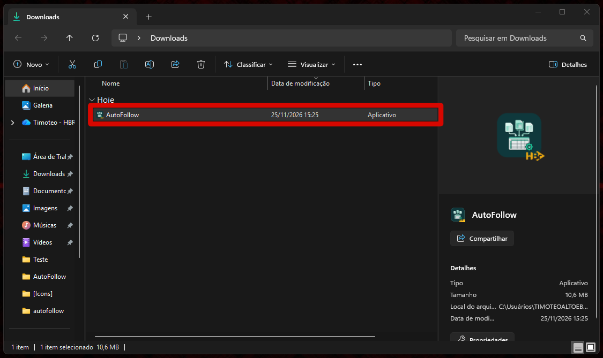 -->

> [!Warning]
> É possível que o *Windows Defender* acuse o programa como "software perigoso". Neste caso, para executá-lo, você deve clicar em `Mais Informações` e, depois, no botão `Executar assim mesmo`.

<!-- 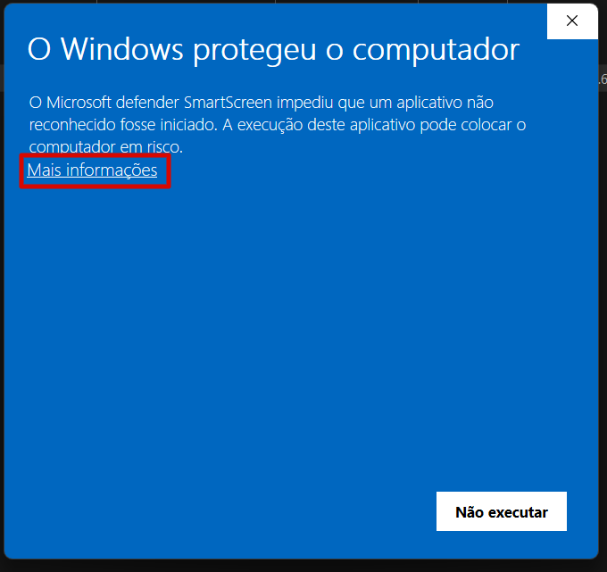 -->

<!-- 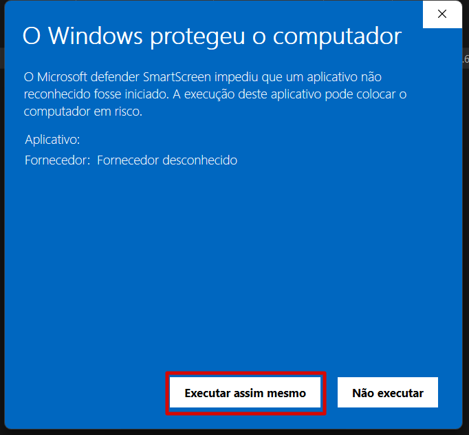 -->

Antes de iniciar uma operação, exporte do Octalink os relatórios que serão associados.

### 2.3 Interface do Programa

<!-- 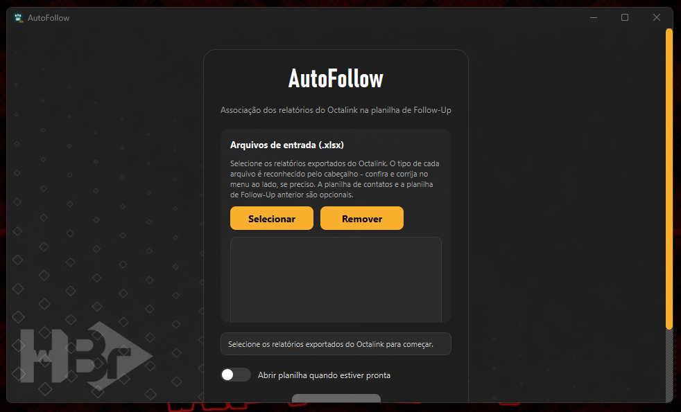 -->

#### 2.3.1 Arquivos de Entrada

O programa possui um único campo para a seleção das planilhas a associar. Para selecioná-las, deve-se clicar no botão `Selecionar`. Feito isso, o programa abre um diálogo do *Explorador de Arquivos*, permitindo que o usuário encontre e selecione os arquivos desejados.

<!-- 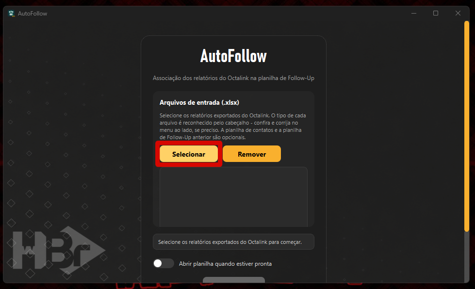 -->

<!-- 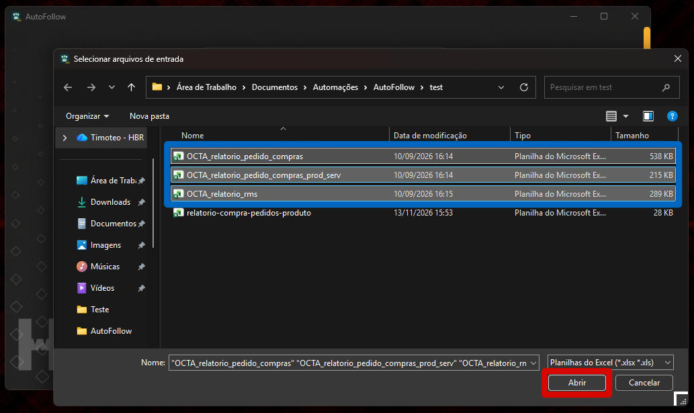 -->

O programa aceita, em qualquer ordem e com qualquer nome de arquivo:

| Planilha | Obrigatória? |
|---|---|
| Relatório de **pedidos de compra** do Octalink | ao menos um dos três |
| Relatório de **produtos** do Octalink | ao menos um dos três |
| Relatório de **RMS** do Octalink | ao menos um dos três |
| **Follow-Up anterior**, para preservar o que já foi preenchido à mão | não |
| **Lista de fornecedores**, para preencher a coluna de contato | não |

> [!Note]
> O tipo de cada planilha é identificado **pelo conteúdo**, e não pelo nome do arquivo: o programa varre as sete primeiras linhas e colunas de cada arquivo procurando as assinaturas de cabeçalho conhecidas. Renomear os arquivos exportados não atrapalha.

Após selecionar os arquivos, a lista é atualizada.

<!-- 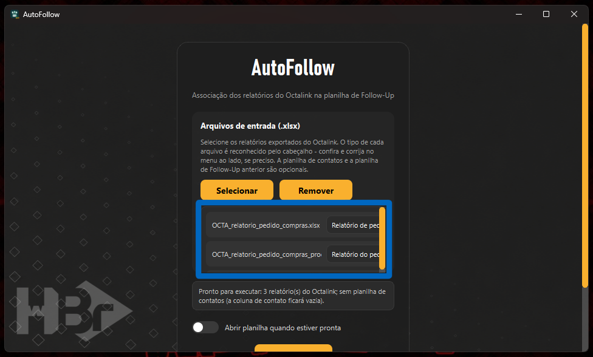 -->

Para remover um arquivo da lista, selecione-o e clique no botão `Remover`.

<!-- 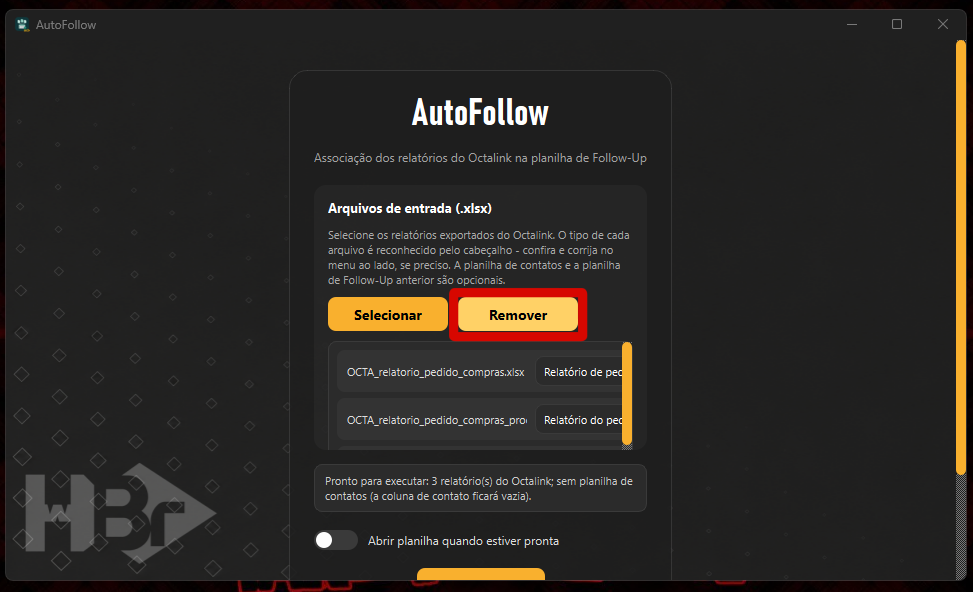 -->

#### 2.3.2 Botão de Execução

Selecionados os arquivos, ao clicar no botão `Executar`, o programa pede onde salvar a planilha de saída e, em seguida, associa os relatórios: cruza os registros pelo código do pedido e da RMS, resolve as divergências pela ordem de precedência configurada e monta a planilha de Follow-Up já formatada como tabela do Excel, com filtros, datas ordenáveis e a escala de status em menu suspenso.

<!-- 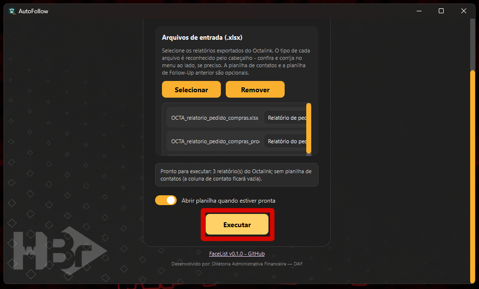 -->

<!-- 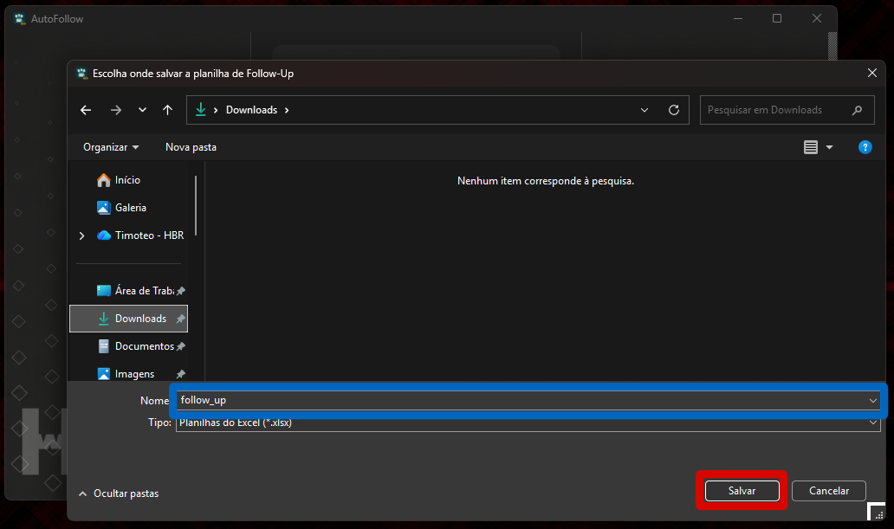 -->

<!-- 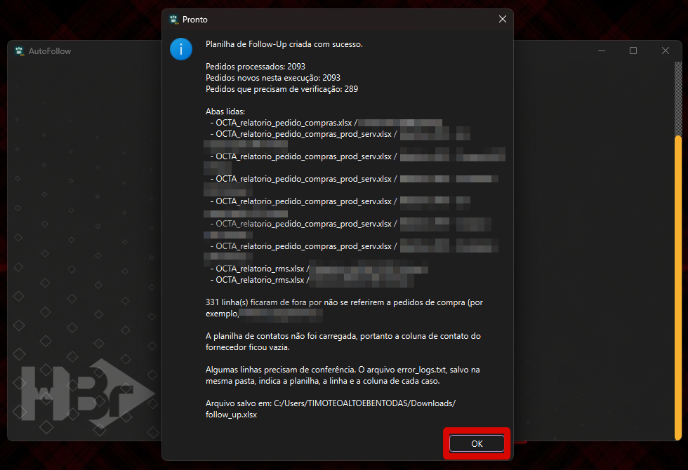 -->

A chave `Abrir planilha quando estiver pronta` faz o programa abrir o resultado no Excel assim que terminar.

Ao final do processamento, além da planilha, é criado um documento de texto `error_logs.txt`, onde são registrados os erros, avisos adicionais e exceções do algoritmo — cada ocorrência nomeando a planilha, a aba, a linha, a coluna, o pedido e a RMS envolvidos, para que a conferência seja direta.

> [!Warning]
> A planilha de saída é uma **proposta de associação**, não um resultado validado. As ocorrências registradas no `error_logs.txt` precisam de conferência humana antes de o arquivo ser usado como base de trabalho.

### 2.4 A Rotina de Anexos

O pacote traz um segundo programa, `AutoFollow_Anexos`, que **não tem interface**: ele é executado pelo Agendador de Tarefas do Windows, uma vez por dia.

Sua função é ler os orçamentos em PDF que o fluxo em nuvem salvou no SharePoint, extrair deles o prazo de entrega — do texto corrido ou das tabelas do documento — e gravar o resultado numa planilha que o fluxo consome de volta.

Para conferir o que ele extrairia, sem gravar nada:

```
AutoFollow_Anexos.exe --simular
```

> [!Note]
> PDFs digitalizados como imagem, sem texto legível, não são lidos: esses casos são registrados e seguem para conferência manual.

## 3. Releases

### `v0.1.0` AutoFollow-Py (*beta release*)

> [!Warning]
> O lançamento beta (*beta release*) foi desenvolvido para **testes internos**, visando identificar e corrigir bugs antes do lançamento de uma versão estável.

Data de lançamento: `__/__/____`

Para fazer o download desta versão, clique [aqui](https://github.com/imbaTIMvel/autofollow_py/releases).

*Release* inicial do programa de associação de relatórios do Octalink.

**Features:**

- Associa os relatórios de pedido, produto e RMS numa única planilha de Follow-Up;
  - Identifica o tipo de cada planilha pelo conteúdo, não pelo nome do arquivo;
  - Varre as sete primeiras linhas e colunas em busca das assinaturas de cabeçalho conhecidas, tolerando mudanças de posição e pequenas variações de grafia;
- Preserva o preenchimento manual de um Follow-Up anterior, quando fornecido;
- Preenche o contato do fornecedor a partir de uma lista, quando fornecida;
- Resolve divergências entre relatórios por ordem de precedência configurável;
- Entrega a planilha formatada como tabela do Excel, com filtros, datas ordenáveis e escala de status em menu suspenso;
- Gera um arquivo `error_logs.txt` com exceções, divergências entre relatórios, campos não identificados e demais ocorrências, cada uma localizada por planilha, aba, linha e coluna;
- Acompanha a rotina `AutoFollow_Anexos`, que extrai prazos de entrega de orçamentos em PDF por *parsing* de texto e de tabelas.

Clique [aqui](https://github.com/imbaTIMvel/autofollow_py/releases) para acessar o **changelog completo**.

## 4. Desenvolvimento

#### Autor:

Timóteo Altoé (*handle:* [imbaTIMvel](https://github.com/imbaTIMvel))

#### Datas:

`__/__/____` Início do projeto

`__/__/____` Lançamento da versão *beta* - para testes

#### Para construir os executáveis:

A partir da raiz do repositório, numa máquina **Windows 64 bits**, com Python 3.10 ou superior:

```
pip install pyinstaller pandas openpyxl PySide6 pdfplumber
python -m PyInstaller --noconfirm --onedir --windowed --name AutoFollow --icon assets/icons/autofollow.ico --add-data "assets/images/bg_hbr.png;." --add-data "assets/icons/autofollow.ico;." src/autofollow.py
python -m PyInstaller --noconfirm --onedir --name AutoFollow_Anexos src/autofollow_anexos.py
```

O PyInstaller precisa ser **6.21.0 ou superior** para Python 3.15.

Rodando os `.py` direto, sem empacotar, o fundo e o ícone da janela não carregam: o código os procura ao lado do script, e no repositório eles moram em `assets/`. É esperado, e só afeta o desenvolvimento.

#### Testes:

```
python src/teste_rapido.py      # processamento ponta a ponta com planilhas fictícias
python src/testes_modelo.py     # bateria de identificação de prazos em e-mails
```

#### A parte em nuvem:

A pasta `power_automate/` traz os dois *Office Scripts* usados pelos fluxos do AutoFollow-PA, que consomem a planilha gerada por este programa. Eles não fazem parte do executável.

---

Este programa produz propostas de associação sujeitas a revisão humana qualificada. Não constitui evidência objetiva nem resultado validado para fins de sistema de gestão da qualidade.
